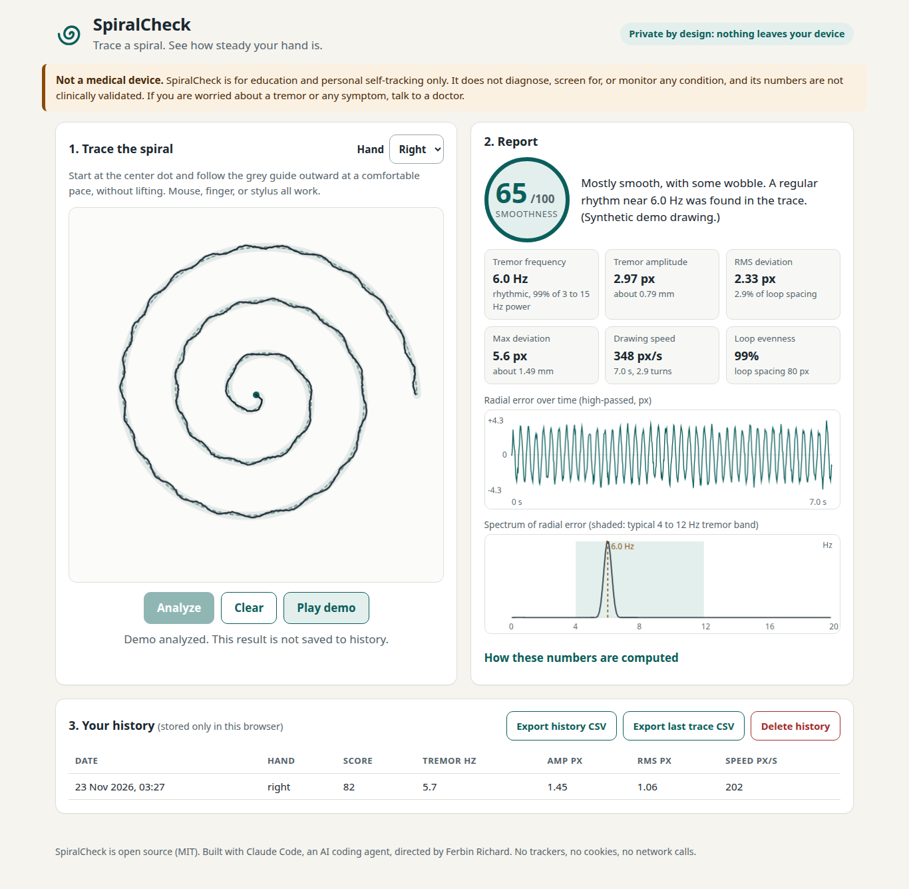

# SpiralCheck

Trace a spiral in your browser and see how steady your hand is: deviation from an ideal spiral, tremor frequency and amplitude, drawing speed, loop evenness, and a 0 to 100 smoothness score. Everything runs locally in the page.

> **Not a medical device.** SpiralCheck is for education and personal self-tracking only. It does not diagnose, screen for, or monitor any condition, and its numbers are not clinically validated. If you are worried about a tremor or any symptom, talk to a doctor.



## What it is

The Archimedes spiral drawing test is a common bedside way to look at hand tremor: a person draws a spiral and a clinician looks at how wobbly it is. SpiralCheck turns the same simple task into numbers you can track over time on your own device:

- **Deviation**: an ideal Archimedes spiral (r = a + b * theta) is fitted to your trace, including its center. RMS and max radial error are reported in px (and nominal mm).
- **Tremor frequency and amplitude**: the radial error is resampled to 100 Hz, slow drift is removed, and a Welch power spectrum (own FFT, Hann window) finds the strongest rhythm between 3 and 15 Hz, with sub-bin peak interpolation.
- **Drawing speed**, duration, number of turns.
- **Loop evenness**: how consistent the spacing between loops is, turn by turn.
- **Smoothness score**: `score = round(100 * exp(-(4D + 8T + C)))`, where D = RMS deviation / loop spacing, T = tremor amplitude / loop spacing, C = coefficient of variation of the per-turn loop spacing. A heuristic, normalized so it does not depend on how big you draw.
- **Plots**: radial error over time and its spectrum, with the peak marked.
- **History** of your results (stored in `localStorage` only), **CSV export** of history and of the raw trace.
- **Play demo** button: plays a synthetic drawing with a 6 Hz tremor and analyzes it, so you can see the full report without drawing. Opening `index.html?demo` starts it automatically.

Input uses Pointer Events with `getCoalescedEvents()`, so mouse, touch, and stylus are all sampled at the full rate the device delivers.

## Run it (3 commands)

```bash
git clone https://github.com/FERBIN12/spiralcheck.git && cd spiralcheck
python3 -m http.server 8000
# open http://localhost:8000
```

No build step and no install. Any static file server works (ES modules need http, not `file://`).

Tests and validation need Node 18 or newer:

```bash
node --test               # unit + synthetic tremor tests
node tools/validate.mjs   # regenerates docs/validation.md
```

## Validation

`tools/validate.mjs` draws synthetic spirals with irregular pointer timing, 0.5 px position noise, slow 2 px hand drift, and a sinusoidal tremor of known frequency (4 to 12 Hz, including non-integer 4.7 and 9.3 Hz) and amplitude (0.5 to 4 px), 10 random seeds per case, then checks what the analyzer recovers. Full tables: [docs/validation.md](docs/validation.md). From the latest run:

| Condition | Frequency within 0.5 Hz | Notes |
|---|---:|---|
| Radial tremor, 120 Hz pointer, 8 s drawing | 360/360 | max error 0.019 Hz, amplitude within 0.95 to 1.05 of truth |
| 60 Hz pointer rate | 360/360 | amplitude reads 0.87 to 0.92 of truth at 9.3 to 12 Hz (interpolation smoothing) |
| Fast drawing (3 turns in 4 s) | 360/360 | max error 0.036 Hz |
| Tremor along a fixed axis (not radial) | 360/360 | known limit: about 0.3 Hz bias, amplitude about 2/3 of truth |
| Clean spirals, no tremor | 0/200 false tremor flags | mean estimated amplitude 0.15 to 0.30 px, max 0.35 px |

At 0.5 px injected amplitude (the size of the noise) the frequency is still found but the tremor flag fires only in some trials, so 0.5 px is the practical floor. These are checks of the signal processing on synthetic data only; they say nothing about clinical accuracy.

## Privacy

- No server, no accounts, no analytics, no cookies, no network requests. The page is static files.
- Drawings and results stay in the browser tab. History is kept in `localStorage` on your device and can be deleted with one button.
- CSV export writes a file to your own device; nothing is uploaded.

## Project layout

```
index.html, style.css, app.js   UI (vanilla JS + canvas)
src/spiral.js                   signal math, pure ES module, no DOM
tests/spiral.test.mjs           node --test suite
tools/validate.mjs              generates docs/validation.md
docs/                           validation results, screenshot
```

## How this was built

SpiralCheck was built with **Claude Code** (an AI coding agent by Anthropic), directed by **Ferbin Richard**, who chose the idea, set the requirements and validation criteria, and reviewed the results. The spiral fitting, FFT, Welch spectrum, UI, tests, and validation script were written with Claude Code during the GenHacks hackathon.

Libraries and tools:

- **Runtime libraries: none.** The FFT, spectrum, fitting, and plots are written from scratch in plain JavaScript.
- Node.js built-in test runner (`node --test`) for tests.
- Python's built-in `http.server` (optional) to serve the files locally.
- Playwright with headless Chromium was used to capture `docs/screenshot.png` and to record the demo video (`tools/record_demo.py`, `tools/build_video.py`); it is not part of the app.

Demo video (captions only): https://youtu.be/B67WwUBICbU

## Disclaimer

SpiralCheck is not a medical device and is not intended to diagnose, treat, cure, or prevent any disease, or to replace professional medical advice. Screen size, pixel density, input device, and posture all change the numbers. Compare only with your own past results taken the same way.

## License

MIT, see [LICENSE](LICENSE). Copyright (c) 2026 Ferbin Richard.
